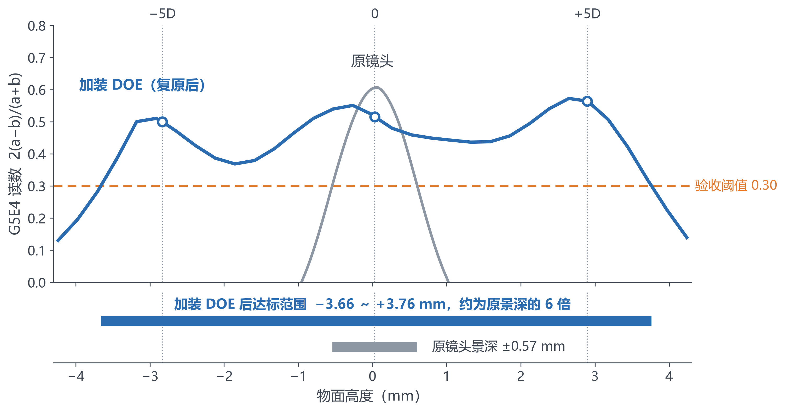
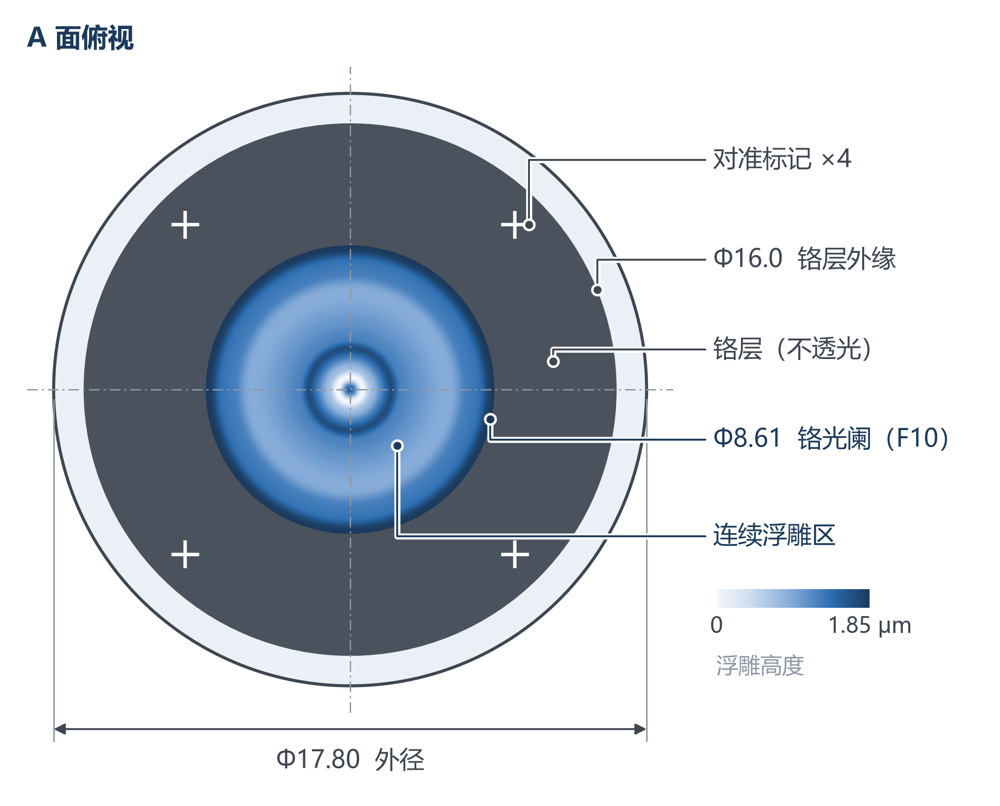
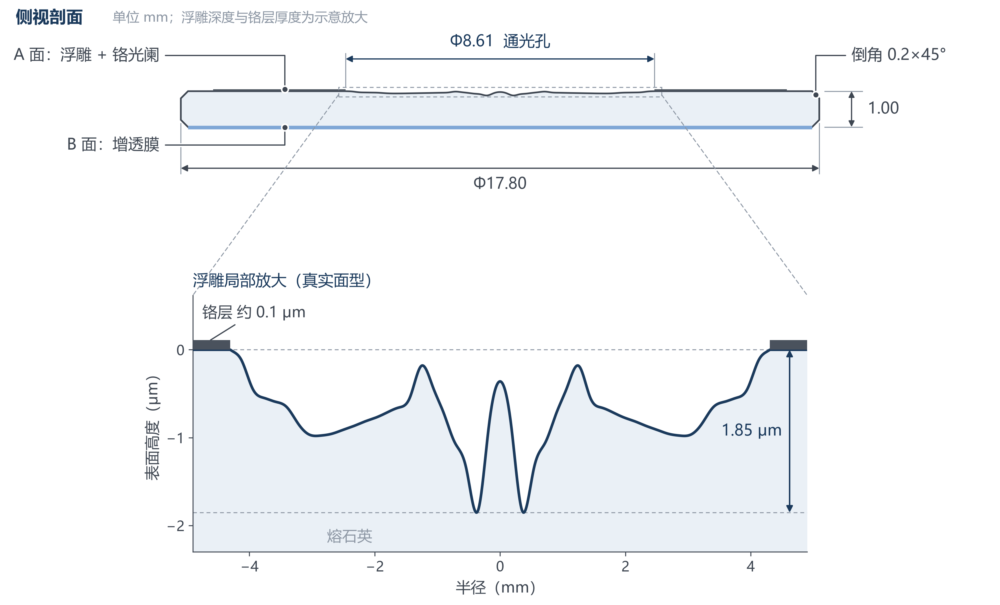
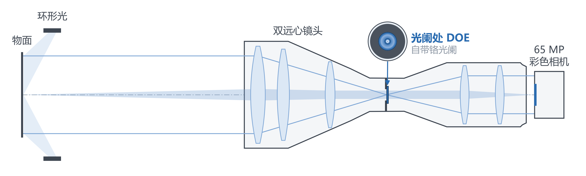

# 工业相机方向超景深 · 甲方汇报 PPT 专用图片

本仓库只存放向甲方汇报所用 PPT 的图片，供团队成员直接取用。每完成一张图就推送一次，进度见下表。

- **PNG**（300 dpi）可直接插入 PPT；同名 **SVG** 为矢量版，可在 PowerPoint 中无损缩放（插入 → 图片 → 此设备）。
- 图片由项目工作区中的脚本生成；数据来自第二轮主设计 **DOE-N10（F10）** 的全链路仿真，与第二轮内部报告、甲方版报告一致。
- 图中只保留必要文字；具体参数建议放在 PPT 正文或口头说明中。

## 进度

| 图 | 文件 | 状态 | 更新 |
|:--|:--|:--|:--|
| 图 1　验收读数随物面高度 | `fig1_readout_vs_height` | 已完成 | 2026-11-10 |
| 图 2a　DOE 俯视图 | `fig2a_doe_top_view` | 已完成 | 2026-11-10 |
| 图 2b　DOE 侧视图 | `fig2b_doe_side_view` | 已完成 | 2026-11-10 |
| 图 4　系统示意 | `fig4_system_schematic` | 已完成 | 2026-11-10 |
| 图 3 素材（6 张） | `fig3_elements/e1～e6` | 已完成 | 2026-11-10 |
| 图 3　系统架构流程图 | `fig3_system_pipeline` | 合成中 | — |

## 各图说明

### 图 1　验收读数随物面高度

- **用途**：“验收结果”页的主图，回答“加装 DOE 后景深扩展了多少”。
- **内容**：
  - 横轴为物面高度，纵轴为 USAF 第 5 组第 4 号（G5E4，线宽 11.05 μm）的读数 2(a−b)/(a+b)，橙色虚线为验收阈值 0.30。
  - 蓝线是加装 DOE 并复原后的读数，灰线是原镜头直接成像的读数。每条曲线都取 9 个测点、正负版、横竖两组中的最差值，按甲方验收方式计算。
  - 顶部 −5D / 0 / +5D 是三个验收高度，空心圆为这三处的读数（0.50 / 0.52 / 0.56）。
  - 下方两条横条为两者的达标范围：原镜头 ±0.57 mm，加装 DOE 后 −3.66 ～ +3.76 mm，约为原景深的 6 倍。
- **仿真条件**（建议口头或在正文说明）：F10，名义镜头像差，65 MP 彩色相机，复原输出噪声 4%，无噪声期望值。
- **相比上一版（`报告/图/fig31_readout_vs_z.png`）的改进**：
  - 去掉了“旧目标”曲线和各测点的虚线，只保留最终结果，并加入原镜头作对照。
  - 去掉了标题里的长括号说明。
  - 用横条直接标出两者的达标范围和倍数，听众不必自己读交点。
  - 字号按投影放大，负号改为标准负号。

### 图 2a　DOE 俯视图（A 面）

- **用途**：“DOE 可制造性”页，与图 2b 并排或上下放置，说明零件结构简单、尺寸常规。
- **内容**：
  - 外径 Φ17.80 的熔石英圆片。
  - 中央 Φ8.61 为铬光阑，即通光孔，它决定系统光圈 F10。光阑内是连续浮雕区，按主设计 DOE-N10 的实际面型渲染，色标表示浮雕高度（最大 1.85 μm）。
  - Φ8.61～Φ16.0 为不透光的铬层，其上有 4 个对准标记（铬层上的十字开口，供光刻套刻）。
  - 最外圈为透明的熔石英边缘，用于装夹定心。
- **相比上一版（`报告/图/DOE_die_drawing.png` 左半部分）的改进**：
  - 俯视图单独成图。
  - 原来压在浮雕区上的红、蓝标注改为右侧引线标注，互不重叠；落在深色铬层上的引线加了白色描边。
  - 浮雕区由示意圆环改为按实际面型渲染，并配色标。
  - 去掉了公差与文字版技术要求，这些内容在加工规格书中，需要时放在 PPT 正文。

### 图 2b　DOE 侧视图（剖面 + 浮雕局部放大）

- **用途**：与图 2a 配合，说明 DOE 只是一块 1 mm 厚的平板，光学结构仅在 A 面中央。浮雕是连续、平缓的面型，高度差不到 2 μm，这是可制造性好的直接证据。
- **内容**：
  - 上半部分为真实比例的剖面：外径 Φ17.80、厚 1.00 mm、倒角 0.2×45°。A 面中央 Φ8.61 通光孔内是浮雕，两侧是铬光阑；B 面镀增透膜。浮雕深度和铬层厚度在剖面中做了示意放大，图中已注明。
  - 下半部分是虚线框处的局部放大，按 DOE-N10 的真实面型绘制，纵轴单位 μm。表面最大高度差 1.85 μm，铬层约 0.1 μm，按真实比例画出。
- **相比上一版（`报告/图/DOE_die_drawing.png` 右上角的“剖面示意”）的改进**：
  - 侧视图单独成图，并增加真实面型的局部放大。上一版只有一条放大约 65 倍的示意曲线，看不出实际尺度。
  - 两面名称和倒角改为引线标注，尺寸线与文字分层摆放，互不重叠。
  - 去掉了公差与文字版技术要求。

### 图 4　系统示意

- **用途**：“技术方案 / 系统组成”页，说明系统由哪些部件组成、DOE 装在哪里。
- **内容**：
  - 从左到右依次为：物面与环形光、双远心镜头、镜头中部光阑处的 DOE、65 MP 彩色相机。镜头外形按 STEP 模型绘制，镜片为示意。
  - DOE 上方是它的俯视缩略图，与图 2a 一致。
  - 蓝色半透明带为轴上物点的成像光束，细线为视场边缘物点的主光线。主光线在物方、像方都平行于光轴，即双远心；各视场的光束在光阑处会聚，DOE 正好放在这里，所以全视场的编码效果一致。
- **相比上一版（`报告/图/fig33_system.png`）的改进**：
  - 解决了 DOE 说明与相机说明的文字重叠。
  - 配色由绿、橙、红、蓝等五种以上颜色减为灰、蓝两个色系：灰色画机械结构，蓝色画光、镜片与 DOE。
  - 去掉了全部括号参数（尺寸、型号、口径、验收高度、工作距离等），只保留部件名称；参数放在 PPT 其他部分或口头说明。
  - 增加了镜片示意、成像光束和 DOE 缩略图，“DOE 在光阑处”一目了然。

### 图 3 素材（`fig3_elements/`）

系统架构流程图的每一步各有一张配图，单独存放，对哪一步不满意可以只替换这一张，再重新合成。素材均为 2.2 英寸见方，与流程图中的卡片同尺寸，内部文字 11 磅。

| 文件 | 对应步骤 | 内容 |
|:--|:--|:--|
| `e1_object` | 被测物体 | 环形光照明下表面起伏的工件；灰带为原镜头景深，浅蓝带为加装 DOE 后的景深（示意） |
| `e2_lens_doe` | 双远心镜头 + DOE | 上：镜头示意（与图 4 同一画法），蓝色为光阑处 DOE；下：DOE 放大俯视图（真实面型） |
| `e3_psf` | 点扩散函数 | 原镜头与加装 DOE 在 −5D、0、+5D 的白光点扩散函数（仿真）。六格统一色标，上限为在焦衍射极限峰值的 0.3，原镜头在焦一格因此饱和。原镜头离焦后散成大光斑，加装 DOE 后三个高度基本一致 |
| `e4_raw` | 单帧采集 | 加装 DOE 后相机直接得到的图像（未复原；负版 USAF 的 G5E3、G5E4 局部；含传感器噪声），三个高度均匀模糊 |
| `e5_restore` | 物理复原 | 复原前后的亮度 MTF。线为五个高度的平均，色带为各高度的范围；同一个复原核作用于所有高度 |
| `e6_output` | 全清晰图像 | 与 e4 同一局部的复原结果，三个高度的 G5E4（11.05 μm 线宽）都清晰可辨 |

仿真条件：主设计 DOE-N10，F10，名义镜头像差，中心测点，复原输出噪声 4%。

## 配色与字体

为与 PPT 其他页面统一，所有图采用同一套配色：

| 用途 | 颜色 |
|:--|:--|
| 主结果（DOE 系统） | 蓝 `#2B6CB0` |
| 标题与强调文字 | 深蓝 `#1B3A5C` |
| 对照（原镜头）与次要元素 | 灰 `#8D97A4` |
| 阈值与关键提示 | 橙 `#E07A2F` |

字体为微软雅黑。
